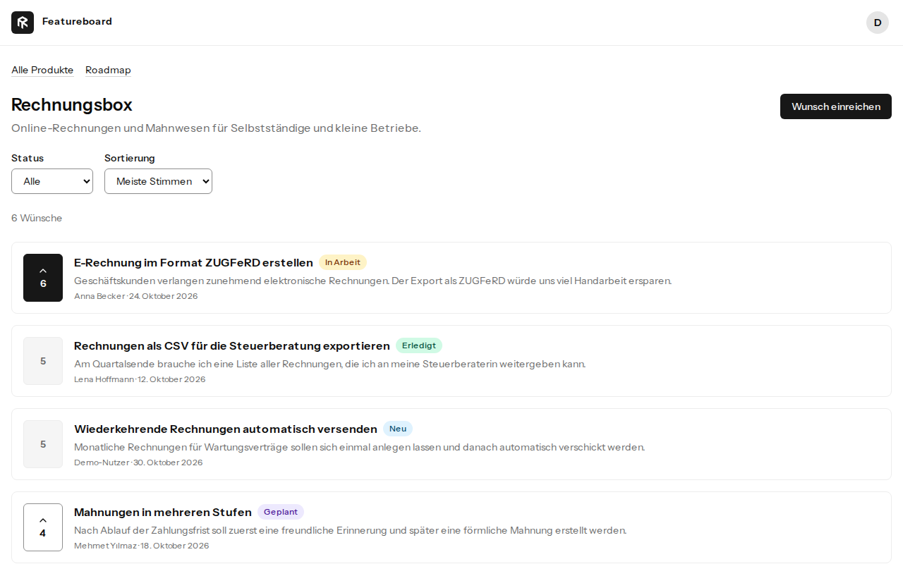
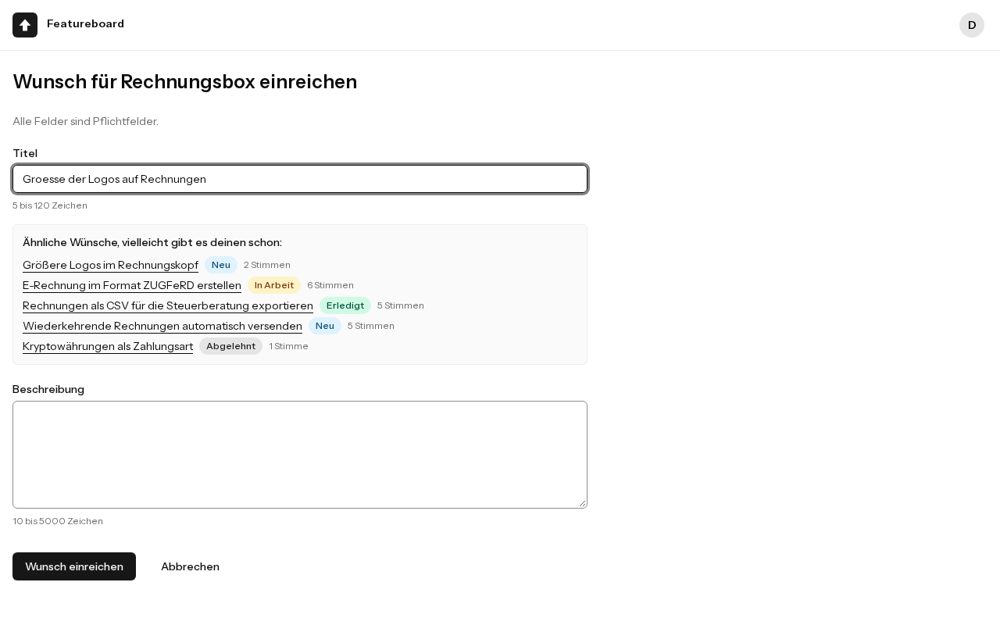
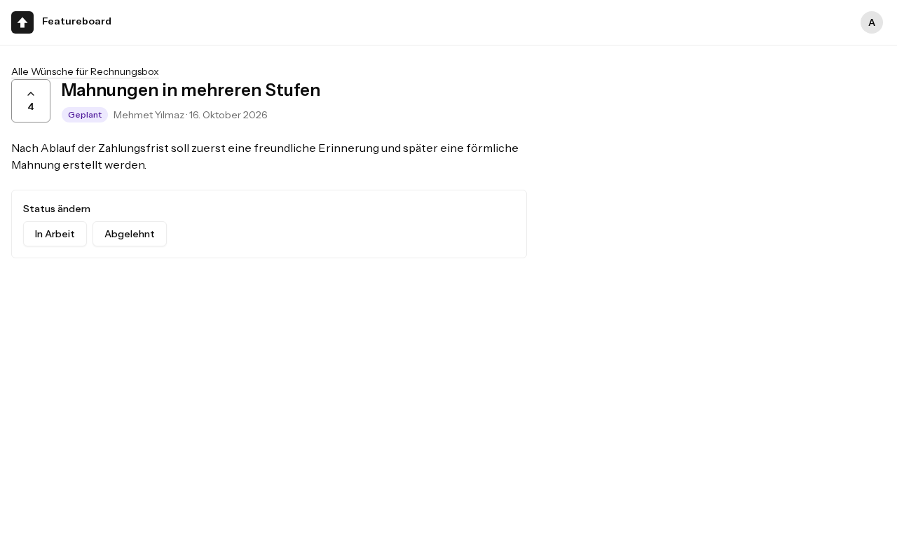
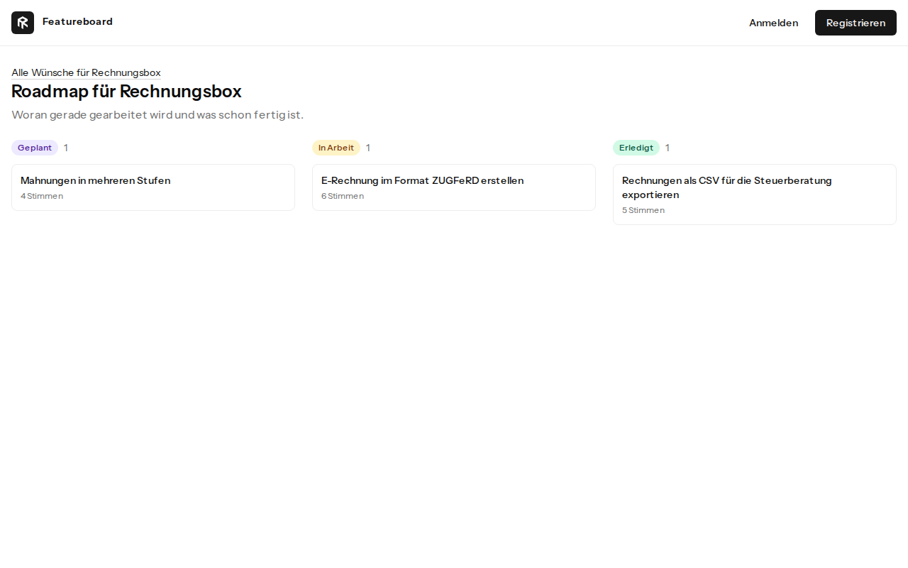

# Featureboard

Ein Board für Produktwünsche mit öffentlicher Roadmap, gebaut mit Laravel, Inertia, Vue und PostgreSQL. Es ist meine Arbeitsprobe für eine Stelle als Laravel-Entwickler. Diese Datei erzählt das ganze Projekt auf Deutsch und in einem Stück: was die Anwendung kann, warum sie so gebaut ist, wie sie geprüft wurde, welche Rolle die KI dabei hatte und was bewusst offen bleibt.



## Die Idee

Wünsche an ein Produkt kommen per E-Mail, als Ticket oder im Chat. Derselbe Wunsch wird dadurch oft mehrfach festgehalten, und am Ende weiß niemand, was die Leute wirklich wollen. Featureboard gibt jedem Produkt einen einzigen öffentlichen Ort dafür.

Der Kern ist ein kleiner Moment im Formular: Schon beim Tippen des Titels erscheinen ähnliche Wünsche. Wer seinen eigenen dort wiederfindet, stimmt direkt an Ort und Stelle dafür ab, und der bereits getippte Text bleibt im Formular stehen. So wird aus einem Duplikat eine Stimme, bevor es überhaupt entsteht.



Die Idee hat Claude Code vorgeschlagen, und ich habe sie aus drei Gründen behalten. Jedes Produktteam kennt das Problem, es braucht also keine Erklärung. Die Anwendung läuft ohne API-Schlüssel und fremde Dienste, jeder kann sie starten, und die Tests liefern immer dasselbe Ergebnis. Und sie ist klein, hat aber echte Regeln, die stimmen müssen, etwa wenn eine Stimme genau in dem Moment eintrifft, in dem ein Admin den Wunsch ablehnt. Der Preis: Boards dieser Art sind ein verbreitetes Demo-Thema. Den Unterschied macht die Abstimmung direkt im Hinweis.

## Schnellstart

Nötig sind nur Git und Docker mit Compose. PHP und Node laufen in den Containern.

```bash
git clone https://github.com/RamonKaes/featureboard.git
cd featureboard
cp .env.example .env
docker run --rm -u "$(id -u):$(id -g)" -v "$(pwd):/var/www/html" -w /var/www/html laravelsail/php84-composer:latest composer install --ignore-platform-reqs
./vendor/bin/sail up -d --wait
./vendor/bin/sail artisan key:generate
./vendor/bin/sail artisan migrate --seed
./vendor/bin/sail npm ci
./vendor/bin/sail npm run build
```

Danach läuft die Anwendung unter <http://localhost:8000>. Die Datenbank liegt auf Port 5434, der Vite-Server auf 5173, weil 80 und 5432 auf meinem Rechner belegt sind. Ist ein Port bei dir vergeben, lässt er sich in der `.env` über `APP_PORT`, `VITE_PORT` oder `FORWARD_DB_PORT` ändern.

Für PHP 8.5 gibt es noch kein Composer-Image von Sail. Die erste Installation nutzt deshalb das Image für 8.4 und überspringt die Plattformprüfung. Die Anwendung selbst läuft im Container auf PHP 8.5.

Getestet ist dieser Ablauf aus einem frischen Klon auf Linux mit x86 und ARM, die Frontend-Werkzeuge zusätzlich nativ auf macOS. Docker Desktop auf einem echten Mac habe ich nicht ausprobiert.

**Demo-Zugänge** (nur für den lokalen Betrieb, Passwort jeweils `password`):

| Rolle  | E-Mail                    |
| ------ | ------------------------- |
| Admin  | `admin@featureboard.test` |
| Nutzer | `demo@featureboard.test`  |

Die Demo-Daten setzt `./vendor/bin/sail artisan migrate:fresh --seed` zurück.

**Alle Prüfungen laufen lassen:**

```bash
./vendor/bin/sail npm run browsers:install
./vendor/bin/sail composer check
```

Der erste Befehl lädt einmalig einen Browser nach `node_modules`. Der zweite führt Pint, Larastan, die Frontend-Prüfungen, die Tests, den Build und die Browser-Tests aus.

## Was die Anwendung kann

Jedes Produkt hat eine Liste von Wünschen, sortierbar nach Stimmen oder Datum und filterbar nach Status, mit fünf Einträgen pro Seite. Lesen darf jeder, auch ohne Konto. Einreichen, Bearbeiten und Abstimmen setzen ein Konto voraus.

Die Fachregeln sind überschaubar:

- **Stimmen:** Jedes Konto hat pro Wunsch eine Stimme. Für den eigenen Wunsch kann man nicht stimmen, für abgeschlossene oder abgelehnte auch nicht.
- **Stimme zurücknehmen:** Das geht in jedem Status. Jede Person behält so die Kontrolle über ihre eigene Stimme, die Zahl eines erledigten Wunsches kann also noch sinken.
- **Bearbeiten:** Nur die Person, die den Wunsch eingereicht hat, und nur solange er den Status `new` hat.
- **Status:** Nur Admins ändern ihn, und nur entlang fester Übergänge.

| Von           | Erlaubt nach              |
| ------------- | ------------------------- |
| `new`         | `planned`, `declined`     |
| `planned`     | `in_progress`, `declined` |
| `in_progress` | `done`                    |
| `done`        | keine, endgültig          |
| `declined`    | keine, endgültig          |

- **Eingaben:** Ein Titel hat 5 bis 120 Zeichen, darunter mindestens drei Buchstaben oder Ziffern, und keine Steuerzeichen für die Schreibrichtung. Eine Beschreibung hat 10 bis 5.000 Zeichen.
- **Konto löschen:** Die Wünsche bleiben ohne Namen öffentlich, die Stimmen der Person verschwinden. Das letzte Admin-Konto lässt sich nicht löschen, weil die Oberfläche keinen neuen Admin ernennen kann.
- **Roadmap:** Jedes Produkt hat eine öffentliche Roadmap mit den Spalten geplant, in Arbeit und erledigt.





Die Oberfläche ist deutsch, Code und die übrige Dokumentation sind auf Englisch.

## Wie sie gebaut ist

### Die Grundlage

Laravel 13, Inertia 3, Vue 3 mit TypeScript, Tailwind 4 und PostgreSQL 18 auf Laravel Sail mit PHP 8.5, aufgesetzt auf dem offiziellen Vue-Starterkit. Das waren beim Start am 3. November 2026 die aktuellen stabilen Versionen. Das Kit kennen Laravel-Entwickler, das erleichtert das Lesen. Sein letzter Tag ist veraltet, deshalb kommt es wie beim offiziellen Installer vom Hauptzweig, und `composer.lock` hält den Stand fest.

Vom Kit habe ich nur Registrierung, Login und Passwort-Reset behalten. Zwei-Faktor-Anmeldung, Passkeys, E-Mail-Bestätigung, Passwortbestätigung, Dashboard, Sidebar und Willkommensseite sind entfernt. Die Fachlichkeit braucht sie nicht, ich muss jede Zeile erklären können, und weniger Code bietet weniger Angriffsfläche. Unbenutzte UI-Bausteine des Kits sind dagegen geblieben: Sie stören nicht, und späteres Vergleichen mit dem Kit bleibt so einfacher.

Das Kit bringt Vite+ mit, das Oxlint und Oxfmt bündelt. Geplant waren eigentlich ESLint und Prettier, aber eine zweite, überlappende Werkzeugkette hätte nichts gebracht. Der Haken ist gemessen: Oxlint prüft die Barrierefreiheit in Vue-Templates nicht. Das musste also anders abgesichert werden, und zwar im Browser.

### Regeln gehören in Aktionen

`CastVote`, `RetractVote`, `ChangeStatus` und `DeleteUser` sind kleine Aktionsklassen. Sie öffnen eine Transaktion, sperren die betroffene Zeile mit `lockForUpdate` und prüfen die Policy erst auf dieser gesperrten Zeile. Eine Prüfung im Controller läse den Datensatz früher und könnte beim Schreiben schon veraltet sein. Eine Stimme, die während einer Ablehnung eintrifft, wartet deshalb auf die Sperre und wird danach abgewiesen.

Interessant war, was die Sperre eigentlich schützt. Ich hatte, oder genauer: die KI hatte angenommen, sie sichere den Zähler. Ohne Sperre blieben die Tests aber grün, denn `increment` ist atomar und doppelte Stimmen fängt die Datenbank ab. Erst als zusätzlich `increment` durch Lesen und Schreiben ersetzt wurde, ging eine Stimme verloren. Geschützt wird in Wahrheit etwas anderes, nämlich der Status während der Abstimmung, und genau dafür gibt es jetzt einen eigenen Test.

Der Statuswechsel zeigt dasselbe Prinzip. Die Oberfläche bietet nur erlaubte Übergänge an, das ist aber nur Komfort. Ein Request lässt sich direkt absetzen, und eine Seite kann veraltet sein. Deshalb prüft `ChangeStatus` Recht und Übergang erneut auf der gesperrten Zeile. Scheitert das, leitet `InvalidStatusTransition` mit einer deutschen Meldung zurück. Die Übergänge selbst stehen an genau einer Stelle, im Enum, ebenso wie die deutschen Bezeichnungen, die das Frontend als Props bekommt. Abweichen kann es so nicht. Weil der Fall erwartet ist, landet er auch nicht als Fehler im Log.

Auch die Regel zum letzten Admin steht in der Aktion. Sie lag erst in einem Validator vor der Transaktion, und zwei Admins, die sich gleichzeitig löschten, zählten dort beide zwei Admins. `DeleteUser` sperrt nun alle Admin-Zeilen in fester Reihenfolge und entscheidet dann. Gezählt wird dabei über die geladenen Zeilen, weil PostgreSQL `FOR UPDATE` zusammen mit `count()` ablehnt. Ausgeloggt wird erst danach, damit eine abgelehnte Löschung die Sitzung nicht beendet.

### Die Datenbank sichert, was sie sichern kann

Eine Stimme pro Konto und Wunsch, gültige Status und nicht-negative Zähler sind Datenbankregeln. „Keine Stimme für den eigenen Wunsch“ oder erlaubte Statusübergänge vergleichen dagegen mehrere Zeilen oder den vorigen Wert und gehören in die Anwendung.

| Fremdschlüssel                | Regel    | Grund                                                                          |
| ----------------------------- | -------- | ------------------------------------------------------------------------------ |
| `feature_requests.product_id` | restrict | Ein Produkt samt Nutzerinhalten zu löschen soll ein bewusster Schritt sein.    |
| `feature_requests.user_id`    | set null | Konten müssen löschbar sein, und fremde Stimmen auf dem Wunsch sollen bleiben. |
| `votes.feature_request_id`    | cascade  | Eine Stimme hat ohne ihren Wunsch keine Bedeutung.                             |
| `votes.user_id`               | cascade  | Wer sein Konto löscht, nimmt seine Stimmen mit.                                |

Die Stimmenzahl steht zusätzlich in `votes_count`, weil die Liste danach sortiert und blättert. Dafür muss der Zähler stimmen. Beim Abstimmen sorgt `increment` dafür. Beim Löschen eines Kontos räumt die Kaskade nur die Stimmen ab, nicht den Zähler. Das korrigiert `DeleteUser`. Ein Datenbank-Trigger wäre robuster, versteckt aber Logik, und anonym behaltene Stimmen würden die Eindeutigkeit aufweichen. Der Preis der gewählten Lösung: Ein direktes `$user->delete()` an der Aktion vorbei ließe die Zähler zu hoch.

Die Admin-Rolle ist ein schlichtes `is_admin`, das sich nicht per Mass Assignment setzen lässt. Es gibt genau zwei Rollen, und ein Rechte-Framework wäre dafür zu viel. Sollte eine dritte kommen, reicht eine kleine Migration.

### Die Suche nach ähnlichen Wünschen

Gesucht war etwas, das deutsche Wortformen und Umlaute versteht. Zur Wahl standen drei Wege:

| Weg           | Stärke                                                             | Schwäche                                                    |
| ------------- | ------------------------------------------------------------------ | ----------------------------------------------------------- |
| Volltextsuche | Wortformen und Umlaute, Rangfolge nach Relevanz, kein neuer Dienst | Trennt keine Komposita, findet keine Tippfehler             |
| `pg_trgm`     | Verträgt Tippfehler und Wortteile                                  | Kennt keine Wortformen, Werte hängen von der Textlänge ab   |
| Laravel Scout | Einheitliche API, mit Meilisearch oder Typesense auch Tippfehler   | Noch ein Paket und ein Dienst für eine einzige kleine Suche |

Die Messung war eindeutig: Mit `pg_trgm` erreicht „Mahnung“ gegen „Mahnungen in mehreren Stufen“ nur 0,26 und „Grösse“ gegen „Größere Logos“ nur 0,17. Beides liegt unter der Standardschwelle von 0,3. Die Volltextsuche findet beides. Sie macht aus „Größe“, „Groesse“ und „Grösse“ denselben Stamm `gross` und aus „Rechnung“ und „Rechnungen“ denselben Stamm `rechnung`.

Umgesetzt ist das als generierte `tsvector`-Spalte mit deutscher Konfiguration, in der der Titel stärker zählt als die Beschreibung, dazu ein GIN-Index und `ts_rank` für die Reihenfolge. Eine generierte Spalte kann nicht auseinanderlaufen. Die Wörter werden mit ODER verknüpft, weil ein Hinweis auch Teiltreffer zeigen soll. Das letzte Wort zählt ab drei Buchstaben auch als Präfix, denn es kann ja noch unfertig sein. Die Abfrage entsteht nur aus Buchstaben und Ziffern, Suchoperatoren aus der Eingabe haben also keine Wirkung.

Ob der Index hilft, zeigt `EXPLAIN ANALYZE` auf 100.020 künstlichen Zeilen:

| Abfrage                               | Plan                                  | Zeit    |
| ------------------------------------- | ------------------------------------- | ------- |
| Seltenes Wort, 20 Treffer             | Bitmap Index Scan über den GIN-Index  | 1,9 ms  |
| Gleiche Abfrage ohne Index-Scans      | Seq Scan                              | 18,2 ms |
| Häufiges Wort, etwa 40 % aller Zeilen | Parallel Seq Scan, vom Planer gewählt | 18,7 ms |
| Kleines Produkt mit 1.000 Zeilen      | Index Scan über `product_id`          | 1,1 ms  |

Der Index wird also nur genutzt, wo er hilft. Das ist richtig, aber weniger eindrucksvoll als der Satz „der Index wird benutzt“. Er belegt rund 10 MB bei einer 28 MB großen Tabelle.

### Die Oberfläche

**Abstimmen fühlt sich sofort an.** Dafür sorgt die `optimistic`-Option von Inertia 3. Sie stellt bei einem Fehler den vorigen Zustand wieder her, eigener Rollback-Code wäre doppelt. Im Browser wurde das mit verzögerter Verbindung geprüft: Die Zahl sprang sofort von 3 auf 2 und nach einem simulierten Netzfehler zurück auf 3. Im Hinweis auf ähnliche Wünsche ist die Liste kein Inertia-Prop, sondern lokaler Zustand. Dort fragt der Hinweis nach der Stimme einfach neu ab, statt die Stimmenlogik zu verdoppeln.

**Verbotenes wird zur Meldung statt zur Fehlerseite.** Ein 403 bei einem Inertia-Besuch würde sonst als Fehlerseite in einem Modal erscheinen. Er kommt ja nur vor, wenn sich der Zustand nach dem Laden der Seite geändert hat, also wird er zu einer Weiterleitung mit deutscher Meldung. Ein direkter Seitenaufruf behält die normale 403-Seite.

**Filter sind nachsichtig.** Ein kaputter Link soll trotzdem die Liste zeigen, deshalb fallen unbekannte oder falsch geformte Filterwerte auf die Vorgaben zurück. Überall dort, wo geschrieben wird, gelten dagegen Form Requests.

**Die Roadmap blättert nicht,** denn sie soll als Ganzes sichtbar sein, und die Datenmenge ist klein. Bei sehr vielen erledigten Wünschen bräuchte die Spalte eine Grenze.

### Feindliche Eingaben und Schutz

PostgreSQL wirft bei IDs außerhalb von `bigint` und bei Text mit NUL-Bytes oder ungültigem UTF-8 Fehler, wo andere Datenbanken nachsichtiger sind. Anfragen wie `?status[]=done` oder `/requests/abc` endeten deshalb nach hunderten grünen Tests in HTTP 500. Jede Korrektur sitzt an der Ursache: Der Routen-Parameter nimmt nur bis zu 18 Ziffern, eine globale Middleware beantwortet NUL-Bytes, ungültiges UTF-8 und ein Array als E-Mail mit 400, Identitätsregeln nutzen `bail`, und die Routen der entfernten Passwortbestätigung antworten mit 404, weil Fortify sie sonst trotzdem registriert.

Dazu kommen benannte Rate-Limits, einige davon als Ersatz für Fortify-Routen ohne eigenes Limit. Die Zahlen sind Schätzungen ohne echte Nutzungsdaten:

| Aktion                    | Limit                                                        |
| ------------------------- | ------------------------------------------------------------ |
| Abstimmen                 | 30 pro Minute und Konto                                      |
| Ähnliche-Suche            | 60 pro Minute und Konto                                      |
| Einreichen und Bearbeiten | 10 pro Minute und Konto                                      |
| Login                     | 5 pro Minute je E-Mail und Adresse, 30 pro Minute je Adresse |
| Registrierung             | 10 pro Stunde und Adresse                                    |
| Passwort-Reset            | 6 pro Minute und Adresse                                     |

Ein Test schlägt fehl, sobald eine schreibende Route weder ein Limit noch eine ausdrücklich genannte Ausnahme hat. Außerdem antwortet die Anwendung außerhalb von lokal und Test nur auf bekannte Hosts, damit ein fremder `Host`-Header den Link in der Reset-Mail nicht vergiftet. Sitzungen enden bei einer Passwortänderung, Passwörter über 72 Byte werden abgewiesen, weil bcrypt sie sonst still abschneidet, eine Middleware setzt die üblichen Sicherheits-Header, und Fehlerseiten gibt es auf Deutsch für jeden Status, mit einem Weg zurück. Eine Content Security Policy fehlt bewusst, denn das Theme-Skript im Seitenkopf bräuchte Nonces, und das lohnt sich ohne echtes Deployment nicht.

## Wie sie geprüft wurde

Die Zahlen sind am aktuellen Code gemessen.

| Prüfung           | Ergebnis                                                                                               |
| ----------------- | ------------------------------------------------------------------------------------------------------ |
| Tests             | 355 Tests mit 1.349 Assertions gegen echtes PostgreSQL, 98,4 % der Zeilen in `app/`                    |
| Browser-Tests     | 107 Tests mit 345 Assertions in Chromium                                                               |
| Statische Analyse | Larastan Stufe 9 ohne Baseline und ohne Ausnahmen, Pint mit strengen Regeln, Vite+, `vue-tsc`          |
| Barrierefreiheit  | axe auf der strengsten Stufe auf allen Seiten, hell und dunkel, als Gast, Nutzer und Admin: 0 Probleme |
| Kontrast          | Berechnet für jeden sichtbaren Text und die Rahmen von Bedienelementen, in beiden Themes               |
| Abfragen          | Konstante Anzahl auf allen Listen und der Detailseite, per Test                                        |

Ein paar Entscheidungen stecken hinter diesen Zeilen:

- **Getestet wird gegen PostgreSQL,** nicht gegen SQLite wie im Kit, weil Volltextsuche, generierte Spalten und gleichzeitige Stimmen vom Verhalten der echten Datenbank abhängen.
- **Larastan läuft auf Stufe 9.** Alle Befunde dort waren echte Typlücken mit sauberer Lösung. Die zusätzlichen Befunde auf Stufe max kommen aus Rückgabetypen des Frameworks und ließen sich nur stummschalten. Tests werden nicht analysiert, weil Pests `$this` dafür eigene Einrichtung bräuchte.
- **Browser-Tests laufen mit dem Pest-Plugin** statt mit Dusk. Die Laravel-Doku empfiehlt das für neue Projekte, Tests und Anwendung teilen sich die Transaktion, und axe ist dabei. Der Browser liegt in `node_modules`, global wird nichts installiert. Das kostet rund 680 MB.
- **Feindliche Eingaben:** Ein Test liest alle Routen aus dem Router und schickt Arrays, NUL-Bytes, ungültiges UTF-8, zu große IDs und mehr, als Gast und als Admin. Nichts davon darf in einem Serverfehler enden. Neue Routen werden automatisch mit angegriffen. Das sind rund 2.000 Anfragen und etwa 50 Sekunden Laufzeit.
- **Nebenläufigkeit:** Echte getrennte Prozesse stimmen gleichzeitig ab und löschen Konten, gegen wirklich gespeicherte Zeilen. Entfernt man die Sperre, werden diese Tests rot. Das wurde ausprobiert, denn ein Test, der nicht scheitern kann, beweist nichts.
- **CI:** GitHub Actions führt bei jedem Push die statischen Prüfungen, die Tests und die Browser-Tests aus. Ein zweiter Workflow, von Hand gestartet, geht diese Anleitung aus einem frischen Klon auf ARM durch und prüft die Frontend-Werkzeuge auf macOS.

### Barrierefreiheit

Das Ziel ist WCAG 2.2 AA. Gefunden wurde vieles, und zwar nicht nur von Werkzeugen:

| Problem                                               | WCAG   | Gefunden durch | Lösung                                             |
| ----------------------------------------------------- | ------ | -------------- | -------------------------------------------------- |
| Gedämpfter Text auf gedämpftem Grund, 4,35:1          | 1.4.3  | Berechnung     | Farbe angehoben, 4,89:1                            |
| Rahmen von Eingabefeldern, 1,26:1 hell, 1,31:1 dunkel | 1.4.11 | Berechnung     | Farbe angehoben, 3,23:1 und 4,30:1                 |
| Rahmen von Outline-Buttons, 1,17:1 hell               | 1.4.11 | Review         | Gleiche Farbe wie Felder, jetzt per Test           |
| Positiver `tabindex` bei Login und Registrierung      | 2.4.3  | axe, Scan      | Entfernt                                           |
| Passwort-Schalter per Tastatur nicht erreichbar       | 2.1.1  | Scan           | `tabindex="-1"` entfernt                           |
| Anmeldeseiten ohne `main`                             | 1.3.1  | axe            | Layout nutzt `main`                                |
| Englische Seiten in einem deutschen Dokument          | 3.1.1  | Review         | Übersetzt                                          |
| Kein Weg am Kopfbereich vorbei                        | 2.4.1  | Review         | Skip-Link                                          |
| Seitenwechsel lautlos, Fokus verloren                 | 2.4.3  | Review         | Fokus wandert zu `main`                            |
| Fokus weg nach Statuswechsel oder Abstimmung          | 2.4.3  | Review         | Fokus wandert zum Status oder zurück zum Button    |
| Formularfehler nicht angesagt oder nicht verknüpft    | 4.1.3  | Review         | `role="alert"`, `aria-describedby`, `aria-invalid` |
| Pflichtfelder nicht als Text markiert                 | 3.3.2  | Review         | Hinweis über dem Formular                          |
| Einstellungsseiten ohne oder mit zwei `h1`            | 1.3.1  | Review         | Genau ein `h1`, per Test gezählt                   |

Die Kontrastwerte am Ende:

| Paar                                               | Hell    | Dunkel  |
| -------------------------------------------------- | ------- | ------- |
| Gedämpfter Text auf Hintergrund                    | 5,33:1  | 7,85:1  |
| Gedämpfter Text auf gedämpftem Grund               | 4,89:1  | 5,77:1  |
| Primärer Button                                    | 17,18:1 | 17,18:1 |
| Fehlertext                                         | 4,77:1  | 5,20:1  |
| Abzeichen „Neu“                                    | 8,24:1  | 12,08:1 |
| Abzeichen „Geplant“                                | 9,29:1  | 12,83:1 |
| Abzeichen „In Arbeit“                              | 8,13:1  | 13,47:1 |
| Abzeichen „Erledigt“                               | 8,47:1  | 13,36:1 |
| Rahmen von Feldern und Outline-Buttons (mind. 3:1) | 3,23:1  | 4,30:1  |
| Fokusring (mind. 3:1)                              | 3,74:1  | 3,94:1  |

Die wichtigste Lehre daraus: axe hat keinen der Kontrastfehler gemeldet. Es überspringt `aria-hidden`-Text und prüft keine Rahmen. Ein grüner Lauf beweist deshalb noch keine Barrierefreiheit, und was das Werkzeug nicht abdeckt, wird berechnet.

### Sicherheit im Überblick

| Bereich         | Ergebnis                                                                                          |
| --------------- | ------------------------------------------------------------------------------------------------- |
| Mass Assignment | `is_admin`, `status`, `votes_count`, `user_id` und `product_id` sind nicht befüllbar, per Test    |
| Autorisierung   | Ein Test schlägt fehl, wenn eine Route weder als öffentlich gelistet noch hinter `auth` liegt     |
| XSS             | Kein `v-html` und keine ungeschützte Blade-Ausgabe im eigenen Code, ein Browser-Test bestätigt es |
| SQL-Injection   | Sucheingabe auf Buchstaben und Ziffern reduziert und gebunden, mit Injection-Texten getestet      |
| Datenabfluss    | Ressourcen nennen ihre Felder ausdrücklich, fremde E-Mail-Adressen tauchen nicht auf              |
| Abhängigkeiten  | `composer audit` und `npm audit` melden keine bekannten Lücken                                    |

### Die Reviews

Alle Prüfungen waren grün, und ich wollte trotzdem wissen, was sie übersehen. Deshalb gibt es `/big-review`, einen feindseligen Prüfauftrag für eine neue Sitzung, die den Code nicht gebaut hat. Er legt seine Verdachtsliste fest, bevor er die Erklärungen des Projekts liest. Er lässt alle Prüfungen und Mutationstests laufen, greift jeden Eingang entlang von zwölf Achsen an (Form, Wert, Struktur, Identität, Frequenz, Nebenläufigkeit, Volumen, Zeit, Zustand, Missbrauch, Fehlerpfad, Darstellung), probiert Missbrauch mit mehreren Konten, misst jede Behauptung der Dokumentation nach und muss aufschreiben, was er nicht geprüft hat.

| Lauf | Modell           | Blocker | Hoch | Mittel | Niedrig |
| ---- | ---------------- | ------- | ---- | ------ | ------- |
| 1    | Claude Opus 5.5  | 4       | 6    | 16     | 8       |
| 2    | Claude Fable 5.1 | 0       | 1    | 4      | 10      |

Vor beiden Läufen war alles grün. Der erste fand zum Beispiel, dass das Tippen eines Titels die Beschreibung löschte, dass Großbuchstaben in der E-Mail ein Konto aussperrten, dass ein fremder `Host`-Header den Reset-Link vergiften konnte und dass Einreichen und Registrieren kein Limit hatten. Der zweite fand vor allem den Wettlauf um den letzten Admin: Beim Nachstellen blieb in 6 von 8 Versuchen kein Admin übrig. Außerdem konnten fünf unsichtbare Zeichen als Titel einen Eintrag erzeugen, dessen Link 0 Pixel breit war.

Alle Blocker und hohen Befunde sind mit Tests behoben, und der zweite Lauf hat in Stichproben bestätigt, dass die Korrekturen aus dem ersten halten. Einen dritten Lauf über die jüngsten Korrekturen gab es nicht.

Das sind Reviews mit Grenzen. Beide liefen im selben Werkzeug, die Projektregeln waren von Anfang an geladen, und keiner ersetzt das Urteil eines unabhängigen Menschen. Auch die Reviews irrten sich: Der zweite schlug für den letzten Admin einen Fix vor, den PostgreSQL ablehnt, und überschätzte eine Lücke in der Login-Antwortzeit, die Laravel auf einem unbelasteten Server verbirgt. Das fiel nur auf, weil die schwersten Befunde vor jeder Korrektur nachgestellt wurden. Der Mutationstest kam im zweiten Lauf auf 78,27 %, vor den danach ergänzten Tests. Jeder überlebende Mutant wurde dabei einzeln eingeordnet, und die mit echtem Wert haben einen Test bekommen.

## Wie mit KI gearbeitet wurde

### Die Werkzeuge

- **Claude Code** in der Claude-Desktop-App mit dem Modell Claude Opus 5.5 hat Code, Tests und Dokumentation geschrieben und die Befehle ausgeführt.
- **Claude Fable 5.1** hat im selben Werkzeug den zweiten Review durchgeführt, den ersten Claude Opus 5.5.
- Der **eingebaute Browser** der App diente zum Prüfen der Oberfläche.
- Das Plugin **a11y-enforcer** lieferte den statischen Scan und die Kontrastberechnung.
- **Laravel Boost** wurde beim Bauen nicht benutzt. Sein MCP-Server scheiterte zunächst am fehlenden Paket, und auf dem Rechner selbst erreicht er die Datenbank nicht, deren Host nur im Sail-Netz auflöst. Er liefert dann sogar ohne Fehlermeldung ein leeres Schema. Jetzt ist er so eingerichtet, dass er über Sail startet, und ein direkter Aufruf lieferte das echte Schema.

### Das Vorgehen

Ich habe einen Auftrag mit neun Etappen und festen Regeln geschrieben. Claude Code hat ihn abgearbeitet, nach jeder Etappe angehalten, mit gemessenen Ergebnissen berichtet, den zentralen Code erklärt und erst nach meiner Freigabe weitergemacht. Die Regeln waren: messen statt raten, Geschäftsregeln testgetrieben, nichts außerhalb der Etappe bauen, und am Ende jeder Etappe ist alles grün.

Meine Steuerung sah so aus:

- Ich habe Anforderungen und Stack vorgegeben und die offenen Fragen entschieden, meist indem ich eine Empfehlung nach Lesen ihrer Abwägung angenommen habe.
- Bei grünen Tests habe ich trotzdem einen feindseligen Review verlangt und ihn als wiederholbaren Prüfauftrag einrichten lassen. Danach habe ich Befund für Befund entschieden, was behoben wird, und Overcoding ausdrücklich ausgeschlossen. Der Rest steht mit Begründung im Abschnitt zu den offenen Befunden.
- Den zweiten Review wollte ich auf einem anderen Modell als dem, das den Code geschrieben hat. Claude startete die Sitzung auf dem Standardmodell und behauptete zuerst, das lasse sich nicht ändern. Ich bestand darauf, und es ging.
- Anwendungscode habe ich nicht von Hand geschrieben. Das hat Claude getan, und die Regeln und Prüfungen haben seine Fehler gefunden.

Dass beim ersten Review das Modell nicht das gewünschte war, fiel erst Minuten später auf, weil niemand es zurückgelesen hatte. Ich habe den Lauf behalten, und seitdem wird nach jedem Start geprüft, was wirklich eingestellt ist.

### Der Weg durch die Etappen

**Bestandsaufnahme.** Noch vor der ersten Zeile Code kam heraus, dass das Kit Vite+ statt ESLint und Prettier mitbringt, sein letzter Tag veraltet ist und die Standardports belegt sind. Der Installationsplan übersah allerdings, dass `create-project` den Feature-Installer schon selbst ausführt. Ich habe die Befehle des Plans ausgeführt und bin darauf gestoßen. Der Ordner wurde mit meiner Zustimmung geleert und das Kit neu aufgesetzt. Immerhin enthält der erste Commit dadurch das unveränderte Kit.

**Entwicklungsumgebung.** Das Einrichten von Sail, Pest, Pint, Larastan und CI brachte mehrere Überraschungen ans Licht: unbenutzte Reste des Feature-Skripts, ein Paket namens `laravel/pao`, das bei erkannten KI-Agenten Argumente an Werkzeuge anhängt, und acht Tests, die nur in einem frischen Klon scheiterten, weil lokal ein alter Build das fehlende Vite-Manifest verdeckte.

**Datenmodell und Fachregeln.** Migrationen, Modelle, Enum, Policy und Aktionen entstanden testgetrieben. Claude erfand dabei `Collection::getOrFail()`, das es nicht gibt, und schrieb ein `->after()` in eine Migration, das nur unter MySQL wirkt. Seine ersten Nebenläufigkeitstests sahen überzeugend aus, blieben aber ohne Sperre grün. Erst der Gegenversuch zeigte, was die Sperre wirklich schützt.

**Oberfläche, Suche, Admin-Bereich.** Im Browser geprüft wurden das Zurückrollen bei verzögerter Verbindung, Stimmen auf veralteten Seiten, Fehlermeldungen samt Fokus, das Escaping von HTML in Nutzertexten und der ganze Admin-Ablauf. Dass der GIN-Index nur bei seltenen Wörtern greift, steht offen in den Messwerten.

**Qualität.** Die ersten Barrierefreiheitstests liefen mit festen IDs wie `/requests/1`. Weil Sequenzen zurückgerollte Tests überleben, prüften sie 404-Seiten und bestanden. Ein misslungener Regex zerstörte das Logo und den Build. Und einmal las Claude einen roten Test als grün, weil es die Ergebniszeile aus der Ausgabe abgeschnitten hatte. Ein ähnlicher Fehler passierte später noch einmal, die Regel macht also nicht immun.

**README.** Ein stiller Schreibfehler führte zu einem Commit, der eine README versprach und nur Screenshots enthielt. Der erste Probeklon teilte sich wegen des gleichen Ordnernamens das Datenbank-Volume mit der Entwicklung, was Claude rechtzeitig bemerkte.

**Nach den Etappen.** Eine Prüfung mit feindlichen Eingaben zeigte die HTTP-500-Fehler. Dann folgten die beiden Reviews mit ihren Korrekturen. Dabei fielen weitere Fehler der KI auf: Die Annahme, `preserveState` halte den Fokus nach einer Stimme, stimmte nicht. Eine gemeinsame `4xx`-Fehlerseite griff nicht, weil Laravels eigene Seiten Vorrang haben. `sail exec` läuft als root und hinterließ fremde Dateien, sodass ein Build scheiterte, und eine abgeschnittene Ausgabe verdeckte das, sodass der Commit herausging, bevor das Ergebnis gelesen war. Ein `git checkout` während einer Mutationsprobe warf nicht committete Arbeit weg, die neu eingespielt werden musste. Und `.mcp.json` stand in der `.gitignore` des Kits, sodass ein Commit die Datei erst nicht enthielt, die er nannte. Die Desktop-Sitzung endete außerdem einmal mitten in einem Testlauf, die Ursache ließ sich nicht klären, verloren ging nichts.

Jede dieser Lehren ist zu einer Regel mit dem auslösenden Fall geworden. Sie alle laufen auf dasselbe hinaus: Grün ist kein Beweis, und ein Test zählt erst, wenn man ihn hat scheitern sehen.

## Was offen bleibt

### Bekannte Grenzen

- **Suche:** Komposita werden nicht getrennt, `Rechnungsexport` findet also nicht `Export`. Manche Verbformen haben verschiedene Stämme, etwa `versenden` und `versendet`. Tippfehler werden nicht gefunden.
- **Barrierefreiheit:** Es gab keinen Test mit einem echten Screenreader wie NVDA oder VoiceOver und keinen vollständigen Tastaturgang durch alle Seiten. Dialoge und Menüs des Kits sind nur mit axe und teilweise von Hand geprüft, Hover-Zustände gar nicht gemessen.
- **Moderation:** Öffentliches lässt sich ohne Datenbankzugriff nicht entfernen. Limits bremsen Spam nur. Auch ein versehentliches `done` oder `declined` ist in der Oberfläche endgültig, und es gibt keine Bestätigung davor.
- **Identität:** Es gilt eine Stimme pro Konto, nicht pro Mensch, weil die E-Mail nicht bestätigt wird. Passwort-Reset und Registrierung verraten, ob ein Konto existiert. Unter hoher Last tut das auch die Antwortzeit des Logins. Limits pro Adresse bremsen alle drei.
- **Offene Wettläufe:** Eine Bearbeitung genau im Moment eines Statuswechsels kann noch durchgehen, weil das Formular ohne Sperre prüft. Ein direktes `$user->delete()` an `DeleteUser` vorbei lässt Stimmenzahlen zu hoch.
- **Größe:** Die Roadmap blättert nicht, fürs Sortieren fehlt noch ein Index, und die Limits sind Schätzungen.
- **Betrieb:** Es gibt kein Deployment und keine Content Security Policy. Die Sicherheits-Header fehlen bei statischen Dateien, die der Webserver direkt ausliefert. Der Seeder legt Konten mit bekanntem Passwort an.
- **Browser:** Die Tests laufen nur in Chromium. Bei mir konnte ein bestehendes Firefox-Profil die lokale Anwendung nicht öffnen, ein frisches schon. Die Ursache habe ich nicht gefunden.

### Bewusst nicht behobene Befunde

Nicht jeder Review-Befund lohnt für eine Demo eine Lösung. Diese bleiben mit Absicht offen, und bei jedem steht, wann es sich neu zu entscheiden lohnt.

| Befund                                                              | Warum es so bleibt                                                                                                                                                                                                 | Neu entscheiden, wenn                            |
| ------------------------------------------------------------------- | ------------------------------------------------------------------------------------------------------------------------------------------------------------------------------------------------------------------ | ------------------------------------------------ |
| Reset und Registrierung verraten, ob ein Konto existiert            | Es auf einem Formular zu verbergen ist sinnlos, solange die Registrierung eine vergebene Adresse ablehnen muss. Richtig ginge es nur mit E-Mail-Bestätigung                                                        | E-Mail-Bestätigung dazukommt                     |
| Fremde Reset-Anfrage macht einen früheren Link ungültig             | Dafür muss jemand die Adresse kennen, es geht nur einmal pro Minute, und ein neuer Link ist schnell angefordert                                                                                                    | Konten wertvoll werden                           |
| Stimmen bleiben, wenn ein Wunsch im Status `new` umgeschrieben wird | Produktentscheidung: Der Auftrag erlaubt das Bearbeiten. Eine Markierung bräuchte eine eigene Spalte, weil auch der Status `updated_at` ändert                                                                     | Missbrauch auftritt oder der Auftrag sich ändert |
| Keine Content Security Policy                                       | Das Theme-Skript bräuchte Nonces, und das bringt ohne Deployment nichts                                                                                                                                            | Die Anwendung live geht                          |
| Abgelaufene Sitzung verliert getippten Text                         | Eine echte Lösung wären Entwürfe im Browser, also eine eigene Funktion                                                                                                                                             | Nutzer das melden                                |
| Sperre der eigenen Zeile in `DeleteUser` ohne Test                  | Der Beweis bräuchte einen langsamen, zeitgesteuerten Test für einen seltenen Wettlauf ums eigene Konto. Das Verhalten wurde über `FOR KEY SHARE` gemessen                                                          | Die Aktion sich ändert                           |
| Timeouts des ersten Mutationslaufs nicht einzeln bewertet           | Der Lauf nennt sie nicht. Der zweite lief ohne Parallelität und hatte keine Timeouts                                                                                                                               | Mutationstests zur Pflicht werden                |
| Übrige überlebende Mutanten                                         | Meldungen, Casts hinter `auth` und Grenzwerte ohne fachliche Bedeutung                                                                                                                                             | Mutationstests zur Pflicht werden                |
| Login über den Stimmen-Button endet auf der Startseite              | Wenig Nutzen für eine Demo, das Ziel müsste durch den Login getragen werden                                                                                                                                        | Gäste wichtiger werden                           |
| Vorschläge bleiben stehen, wenn der Titel 120 Zeichen übersteigt    | Harmlos, das Feld zeigt seine Grenze                                                                                                                                                                               | Für sich allein nie                              |
| Unbenutzter Kit-Code                                                | Kein Einfluss aufs Verhalten, und Vergleiche mit dem Kit blieben schwieriger                                                                                                                                       | Dem Kit nicht mehr gefolgt wird                  |
| Namen wie „Admin“ und unsichtbare Zeichen im Namen                  | Bräuchte eine Namensregel, und Admins tragen ohnehin kein sichtbares Abzeichen                                                                                                                                     | Moderation dazukommt                             |
| Roadmap ohne Grenze                                                 | Nur Admins lassen die Spalte `done` wachsen, und die Demo bleibt klein                                                                                                                                             | Ein Produkt viele erledigte Wünsche sammelt      |
| Antwortzeit des Logins unter Last                                   | Laravels Mindestdauer von 200 ms verbirgt es im Leerlauf (0,26 s für beide). Unter Volllast brauchten bekannte Konten 0,35 bis 0,61 s, unbekannte 0,29 bis 0,33 s. Das Limit pro Adresse begrenzt, was man erfährt | Die Anwendung live geht                          |
| Langer Query-Schlüssel wird in die Blätter-Links gespiegelt         | Kostet nur die Bandbreite des Absenders                                                                                                                                                                            | Die Liste zur öffentlichen API wird              |
| `back()` folgt dem `Referer`                                        | Dritte können es wegen CSRF-Token und `SameSite=Lax` nicht auslösen                                                                                                                                                | Für sich allein nie                              |
| Kein `trustProxies`, `X-Powered-By` wird gesendet                   | Beides hängt vom echten Server ab                                                                                                                                                                                  | Die Anwendung live geht                          |
| Erfolgsmeldung im dunklen Modus unauffällig                         | Der Text ist mit 18,97:1 gut lesbar, nur der Rahmen ist blass                                                                                                                                                      | Nutzer die Meldung übersehen                     |
| `email` akzeptiert `a@b`                                            | Das ist nach RFC gültig, und DNS-Prüfungen bringen ohne Bestätigung wenig                                                                                                                                          | E-Mail-Bestätigung dazukommt                     |
| `Too Many Attempts.` als JSON ist unübersetzt                       | Nur die Suchanfrage sieht es, die Oberfläche zeigt den Text nicht                                                                                                                                                  | Für sich allein nie                              |

### Ideen für später

Das sind ausdrücklich keine Pläne:

- Eine Lint-Regel für die Barrierefreiheit in Vue-Templates
- Indizes fürs Sortieren nach Stimmen und Datum, sobald größere Datenmengen sie brauchen
- Volltextsuche mit `pg_trgm` kombinieren, um auch Tippfehler und Wortteile zu finden
- In Listen nur die nötigen Spalten laden, damit die `tsvector`-Spalte nicht mitkommt
- Eine Rückfrage vor den endgültigen Status `done` und `declined`
- Die `done`-Spalte der Roadmap bei vielen erledigten Wünschen begrenzen
- Ein Test mit einem echten Screenreader
- Eine Content Security Policy
- Etwas mehr Abstand unter den Zurück-Links auf Detail- und Roadmap-Seite

## Lizenz

MIT, Copyright (c) 2026 Ramon Kaes.
