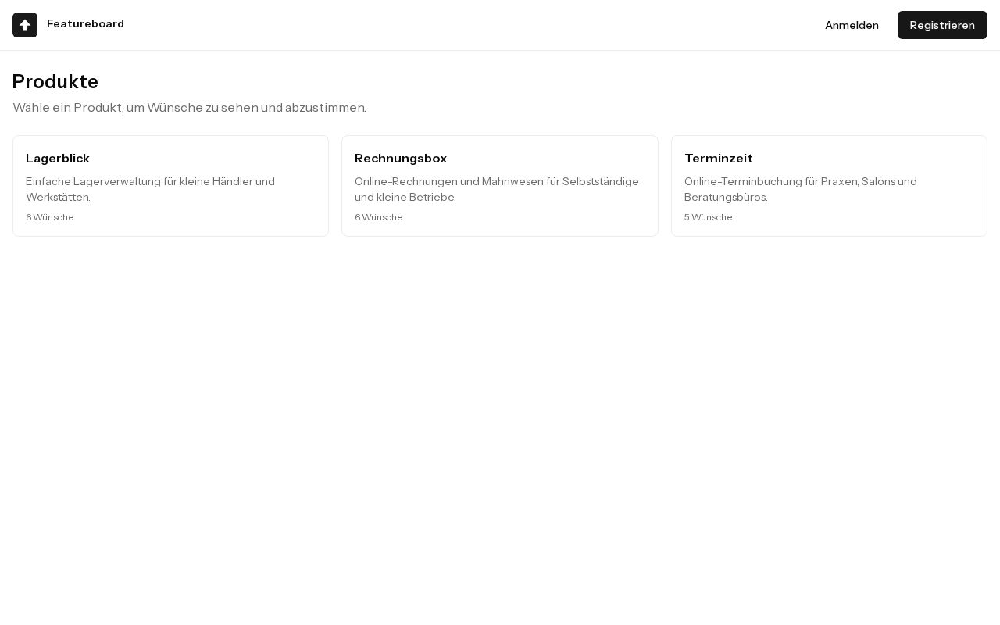
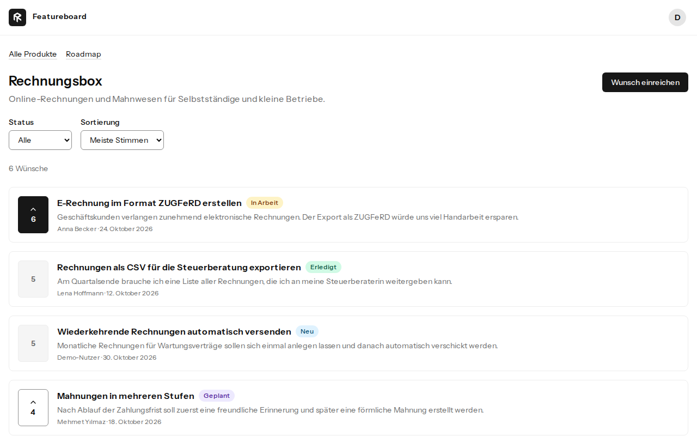
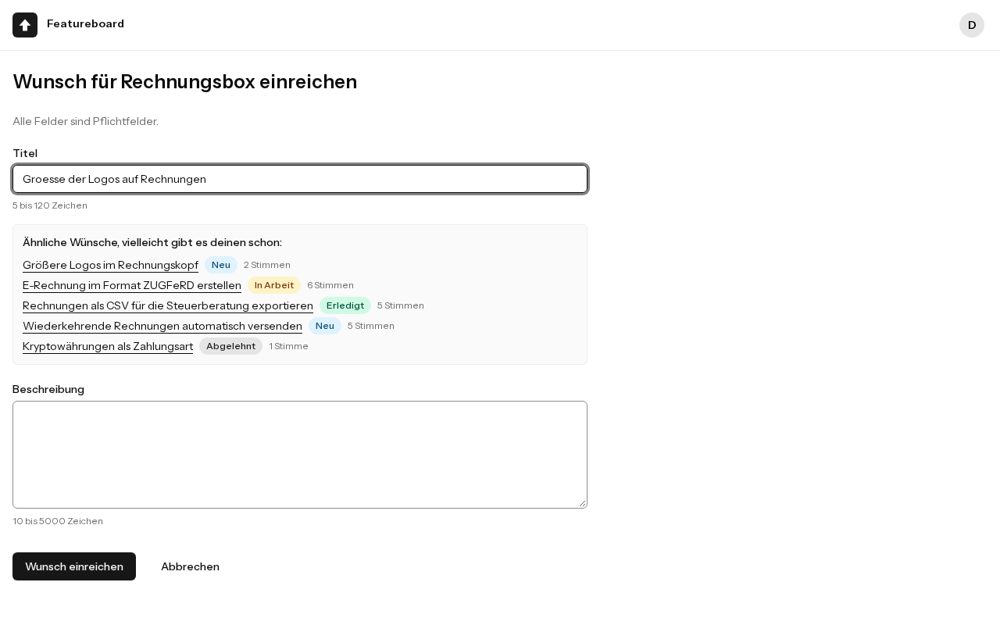
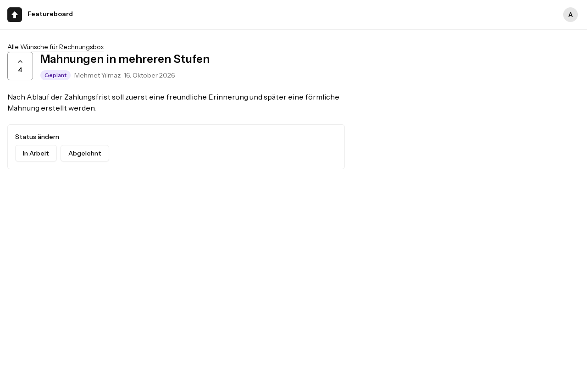
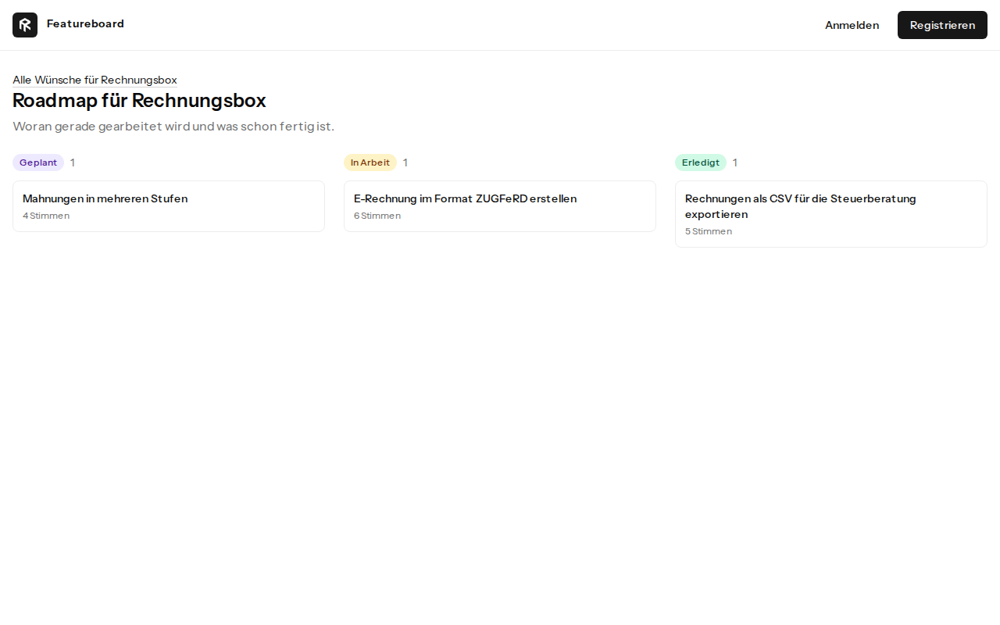

# Featureboard

Feature request and roadmap board for software products, built with Laravel, Inertia, Vue and PostgreSQL.

## Setup

You need Git and Docker with Compose. PHP and Node run inside the containers.

```bash
git clone https://github.com/RamonKaes/featureboard.git
cd featureboard
cp .env.example .env
docker run --rm -u "$(id -u):$(id -g)" -v "$(pwd):/var/www/html" -w /var/www/html laravelsail/php84-composer:latest composer install --ignore-platform-reqs
./vendor/bin/sail up -d --wait
./vendor/bin/sail artisan key:generate
./vendor/bin/sail artisan migrate --seed
./vendor/bin/sail npm ci
./vendor/bin/sail npm run build
```

Open <http://localhost:8000>. If a port is taken, change `APP_PORT`, `VITE_PORT` or `FORWARD_DB_PORT` in `.env`.

There is no Sail Composer image for PHP 8.5 yet, so the first install uses the 8.4 image and ignores the platform check. The app itself runs on PHP 8.5 inside the Sail container.

### Demo accounts

All accounts use the password `password` and are for local use only.

| Role  | Email                     |
| ----- | ------------------------- |
| Admin | `admin@featureboard.test` |
| User  | `demo@featureboard.test`  |

To reset the demo data, run `./vendor/bin/sail artisan migrate:fresh --seed`.

### Running the checks

```bash
./vendor/bin/sail npm run browsers:install
./vendor/bin/sail composer check
```

The first command downloads a browser into `node_modules` and is needed once. `composer check` runs Pint, Larastan, the frontend checks, the tests, the build and the browser tests.

## Idea

Software teams collect feature wishes in emails, tickets and chats, so duplicates pile up and nobody sees what users really want. Featureboard gives each product one public place:

- Users submit wishes and vote for those of others, one vote per person.
- While someone types a title, the form shows similar existing wishes, so fewer duplicates appear.
- Admins move wishes through a fixed workflow: `new`, `planned`, `in_progress`, `done`, with `declined` possible from the first two.
- A public roadmap shows what is planned, in progress and done, without an account.

The interface is in German, and the code and documentation are in English.











## AI tools used

- **Claude Code** in the Claude desktop app, with the model Claude Opus 5.5, wrote the code, tests and documentation and ran the commands.
- The app's **built-in browser** was used to check the interface.
- The **a11y-enforcer** plugin provided the static accessibility scan and the contrast calculation.

The Laravel Boost MCP server was configured, but it failed to connect and was not used. No other AI tools were involved.

## Approach

I wrote a brief with nine stages and fixed rules, and Claude Code worked through it. After every stage it stopped, reported with measured results and explained the central code, and it continued only after my approval. The rules are in [CLAUDE.md](CLAUDE.md), and every stage is logged in [docs/AI-WORKFLOW.md](docs/AI-WORKFLOW.md).

**What the rules were for:** Measure instead of guessing, test business rules first, stay within the stage's scope, and keep everything green.

**My part:** I set the requirements and the stack, and I decided the open questions, usually by accepting a recommendation after reading its trade-offs. For example, I accepted Vite+ instead of the planned ESLint and Prettier.

**Where the AI was wrong:** I did not correct its code by hand. The mistakes were caught by running things, which is the point of the rules:

- Its setup plan ignored that `create-project` already runs the kit's feature installer. I ran the plan's commands and hit the problem, and the kit had to be reinstalled.
- Its first concurrency tests stayed green with the row lock removed, because it had assumed the lock protected the vote count. A mutation check showed that the lock protects something else, and a new test now covers that.
- Its first accessibility tests checked 404 pages, because they assumed database ids.
- It once read a failing test as passing, because it had cut the result line from the output.
- Anonymous requests like `?status[]=done` or `/requests/abc` ended in HTTP 500, after hundreds of green tests that only sent valid input. A guard that attacks every route with hostile input found these and more.

Each lesson became a rule in `CLAUDE.md`, together with the case that caused it.

## Architecture decisions

The full reasoning, with options and measurements, is in [docs/DECISIONS.md](docs/DECISIONS.md).

- **Stack:** Laravel 13, Inertia 3, Vue 3 with TypeScript, Tailwind 4, PostgreSQL 18 and Sail, based on the official Vue starter kit.
- **Status workflow:** The allowed transitions live in one enum. The interface offers only those, and the backend checks them again.
- **Rules in actions:** `CastVote`, `RetractVote` and `ChangeStatus` lock the row in a transaction and run the policy on the locked row, so a check cannot be outdated when the write happens.
- **Stored vote count:** `votes_count` makes sorting simple. Atomic increments keep it correct, and `DeleteUser` corrects it when an account is deleted.
- **Database constraints:** A unique vote per user and request, a status check, a non-negative count, and deliberate delete rules. For example, a request stays anonymously when its author is deleted.
- **Full-text search over `pg_trgm` or Scout:** A generated, weighted `tsvector` column with the `german` configuration and a GIN index handles word forms and umlauts without another service.
- **Optimistic voting:** Inertia's own `optimistic` option restores the previous state on failure, so there is no custom rollback code.
- **Only two roles:** A non-fillable `is_admin` boolean, without a permissions framework.
- **Reduced kit:** Two-factor authentication, passkeys, email verification, the dashboard and the sidebar were removed.

## Quality assurance

All numbers were measured on the final code. See [docs/QUALITY.md](docs/QUALITY.md) for the audit.

| Check         | Result                                                                        |
| ------------- | ----------------------------------------------------------------------------- |
| Tests         | 275 tests with 960 assertions, against PostgreSQL                             |
| Browser tests | 46 tests with 102 assertions                                                  |
| Coverage      | 98.2% of lines in `app/`, without browser tests                               |
| Larastan      | Level 9, 0 errors, no baseline and no ignored errors                          |
| Pint          | Laravel preset plus strict types and strict comparison                        |
| Frontend      | Vite+ lint and format, `vue-tsc` without errors                               |
| Accessibility | axe at its strictest level on all pages, light and dark, 0 issues             |
| Contrast      | Calculated from rendered colors, at least 4.5:1 for text and 3:1 for borders  |
| Index use     | `EXPLAIN ANALYZE` on 100,020 rows: 1.9 ms with the GIN index, 18.2 ms without |
| Query counts  | Constant per page, tested and protected by `preventLazyLoading`               |
| Rate limits   | 30 votes and 60 searches per minute per user, tested                          |

- **Hostile input:** A test takes every route from the router and sends arrays, NUL bytes, invalid UTF-8, overflowing ids and more in every known field and path parameter, as guest and as admin. None may end in a server error.
- **Concurrency:** Separate processes vote at the same moment against committed rows. Removing the lock or the atomic increment makes these tests fail, which was checked by mutation.
- **CI:** GitHub Actions runs Pint, Larastan, the frontend checks, the tests with a PostgreSQL service, the build and the browser tests.
- **Limits of the tools:** axe missed two contrast failures that the calculation found, so green tools alone are not treated as proof.

## Known limitations

- **Search:** Compound words are not split, so `Rechnungsexport` does not find `Export`. Some verb forms have different stems, like `versenden` and `versendet`, and typos are not found.
- **Accessibility:** No test with a real screen reader and no complete manual keyboard walk through every page. Kit dialogs and menus were only checked by axe.
- **Vote counts:** A direct `$user->delete()` that bypasses the `DeleteUser` action leaves counts too high.
- **Editing:** The edit form checks its permission without a row lock, so an edit at the exact moment of a status change can still go through.
- **Status changes:** `done` and `declined` are final and have no confirmation step, so a misclick cannot be undone in the interface.
- **Votes on finished requests:** Votes can still be retracted, so the count of a finished request can go down.
- **Roadmap:** No pagination, so the `done` column grows with the product.
- **Sorting:** No index for sorting by votes or date yet, because the demo data does not need one.
- **Rate limits:** The limits are estimates without real usage data.
- **Security:** No security headers such as a Content Security Policy, and no production deployment. The seeder creates accounts with a known password.
- **Browsers:** Browser tests run in Chromium only. On my machine one existing Firefox profile could not open the local app. A fresh Firefox profile worked, and I did not find the cause.
